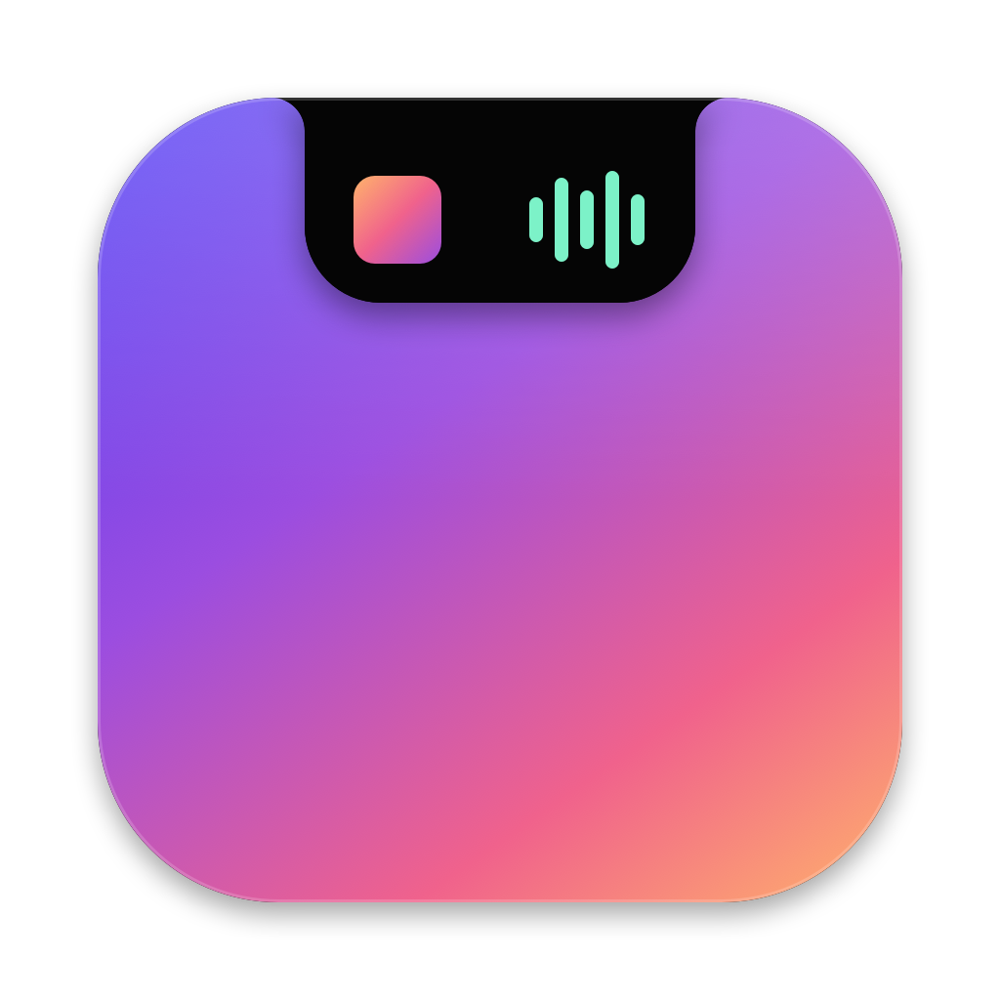

<p align="center">
  
</p>

<h1 align="center">Notchella</h1>

<p align="center">
  <b>Your MacBook's notch, finally useful.</b><br>
  A free, open-source macOS app that turns the notch into a home for your music, calendar, AI agents, Xcode builds and files.
</p>

<p align="center">
  <a href="https://notchella.kellydanielo.com"><b>Download</b></a> ·
  <a href="https://notchella.kellydanielo.com">Website</a> ·
  <a href="#building-from-source">Build from source</a>
</p>

---

Notchella sits in the notch. When something's happening, a live activity slides out beside it. Hover to open the full view, move away and it tucks itself back in. On Macs and displays without a notch, it draws a slim virtual one.

## Features

| | |
|---|---|
| **Now playing** | Artwork, a live visualizer and full playback controls for Spotify and Apple Music. |
| **Synced lyrics** | Line-by-line lyrics from [LRCLIB](https://lrclib.net), in the player or under the closed notch. |
| **Calendar** | Today's events from every calendar on your Mac. |
| **AI agents** | See when Claude Code or Codex is working, waiting for input or done. Optional hooks give exact status. |
| **Keep awake** | Stop the Mac sleeping while agents run, or always. |
| **Xcode builds** | Build progress and results from Xcode and `xcodebuild`, with an optional failure sound. No setup. |
| **Dev tools** | Running localhost servers, plus one-click JSON formatting and a screen color picker. |
| **Volume & brightness HUD** | A replacement for the system overlay. Hold <kbd>⌥</kbd><kbd>⇧</kbd> for finer steps. |
| **Battery** | A charging activity and an optional "charged to 80/90/100%" alert. |
| **Keyword alerts** | Surface notifications that contain words you choose, like a name or "call me". |
| **Shelf** | Drag files onto the notch to park them, then drag them out later. |
| **Reflect** | Daily affirmations and one line of gratitude. |

Updates arrive automatically through [Sparkle](https://sparkle-project.org).

## Install

1. Download `Notchella.dmg` from [notchella.kellydanielo.com](https://notchella.kellydanielo.com).
2. Drag Notchella into Applications and open it.
3. Hover the notch. Settings live behind the menu bar icon.

Requires macOS 15.6 or later. Runs natively on Apple silicon and Intel.

### Permissions

All of them are optional; each feature works on its own.

- **Accessibility**: the volume and brightness keys, and reading notification banners for keyword alerts.
- **Calendar**: showing your events.
- **Automation**: controlling Spotify and Apple Music.

### Privacy

Notchella has no accounts, analytics or tracking. Everything runs on your Mac. Its only network requests fetch synced lyrics from LRCLIB, album artwork for the current song, and Sparkle's daily update check.

## Building from source

Requirements: Xcode 27 or later.

```bash
git clone https://github.com/KellyDanielO/notchella.git
cd notchella
open notchappp.xcodeproj
```

In Xcode, select your own team under **Signing & Capabilities** (the project is set to the maintainer's team), then build and run the `notchappp` scheme. Swift Package Manager fetches Sparkle on the first build.

For screenshots and layout work, Debug builds accept launch arguments that keep the notch open:

```
-NotchOpenOnLaunch YES -NotchOpenTab home   # home | reflect | dev | shelf
```

### Project layout

```
notchappp/
  App/          App entry point, delegate and the model that owns every service
  Core/         Notch geometry, window, settings and shared utilities
  Features/     One folder per feature (Music, Lyrics, Calendar, Agents, Xcode, HUD, …),
                each split into Models, Services and Views
  UI/           The closed and open notch views and shared components
Config/         Info.plist keys for Sparkle and the hardened-runtime entitlements
Design/         The app icon source
scripts/        release.sh
```

## Releasing

`scripts/release.sh` builds a universal Release, signs and notarizes it, packages the DMG, signs the update for Sparkle and writes the appcast into the website repo:

```bash
scripts/release.sh 1.0.2 [release-notes.html]
```

It needs, on the maintainer's machine:

- a **Developer ID Application** certificate in the keychain,
- a `notarytool` keychain profile named `notchella` (`xcrun notarytool store-credentials`),
- the Sparkle EdDSA private key in the keychain (from Sparkle's `generate_keys`),
- the website repo at `~/Documents/web/notchella_web` (or `NOTCHELLA_WEB`).

**Publishing your own fork?** Generate your own Sparkle key pair and change `SUFeedURL` and `SUPublicEDKey` in `Config/Info.plist`, so your builds don't check for, or accept, updates from this project's feed.

## Contributing

Issues and pull requests are welcome. For anything bigger than a small fix, open an issue first so we can agree on the approach.

## Author

Made by [Kelly Daniel](https://kellydanielo.com). Questions or feedback: [kellyappdev@gmail.com](mailto:kellyappdev@gmail.com).
